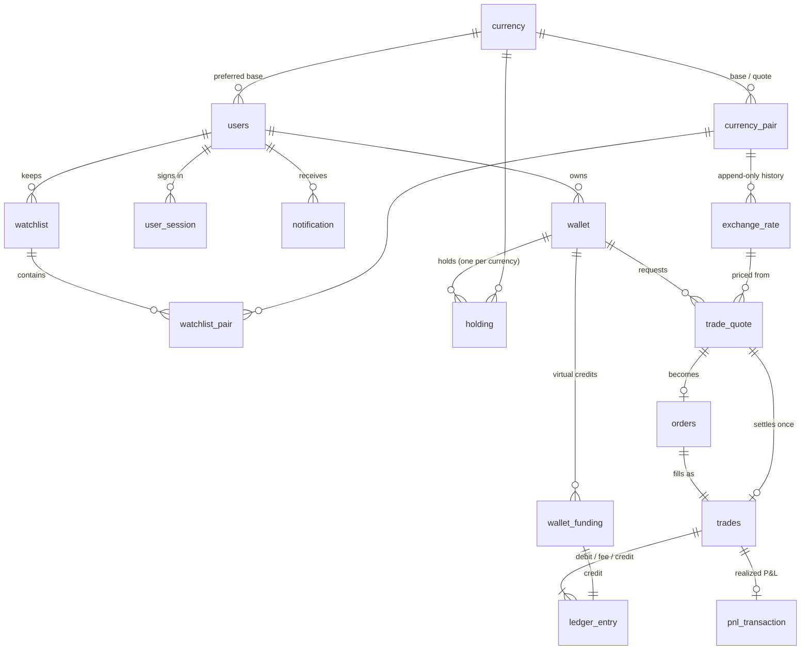

# Database Schema

Valora Money uses PostgreSQL 16. The schema is created by Alembic migrations in
`backend/migrations/versions/`:

| Migration | Contents |
|---|---|
| `0001_initial_schema.py` | Every table, constraint and index (generated from `backend/app/models/__init__.py`). |
| `0002_financial_triggers.py` | Triggers that enforce the financial rules inside the database. |

**Types used throughout:** money and quantities are `NUMERIC(24,8)`, rates are `NUMERIC(24,10)`, and
average costs are `NUMERIC(28,10)`. Every timestamp is `TIMESTAMPTZ`. There are no `FLOAT` or `REAL`
columns anywhere. In Python, values are handled as `decimal.Decimal`, and the API sends them as JSON
strings.

## Entity–relationship overview

## Tables

### `currency`
The supported currencies, configurable through the database.

| Column | Type | Notes |
|---|---|---|
| currency_id | SMALLINT PK | |
| currency_code | VARCHAR(3) UNIQUE | `CHECK (currency_code ~ '^[A-Z]{3}$')` |
| currency_name, currency_symbol, country | VARCHAR | Used by the search box ("euro", "japan", "GBP") |
| decimals | SMALLINT | Minor units: 2, or 0 for JPY. Every amount is quantized to this. |
| display_order | SMALLINT | |
| status | VARCHAR | `ACTIVE` / `INACTIVE` |

### `users`
| Column | Type | Notes |
|---|---|---|
| user_id | BIGINT PK | |
| full_name, username, email, phone, country | | `username` and `email` are unique case-insensitively, via indexes on `lower(...)` |
| password_hash | VARCHAR(255) | Argon2id. Passwords are never stored in plaintext. |
| base_currency_id | FK → currency | Preferred currency |
| is_demo | BOOLEAN | Marks seeded demonstration accounts |
| created_at, updated_at | TIMESTAMPTZ | `updated_at` is maintained by a trigger |
| account_status | VARCHAR | `ACTIVE` / `SUSPENDED` / `CLOSED` |

### `user_session`
One row per login. The session cookie carries a signed JWT whose `sid` must match an unexpired,
unrevoked row here. That means logout and password changes revoke sessions on the server, not just
in the browser.

### `wallet`: the account
| Column | Type | Notes |
|---|---|---|
| wallet_id | BIGINT PK | |
| user_id | FK → users (RESTRICT) | **Partial unique index:** one `ACTIVE` wallet per user |
| wallet_reference | VARCHAR UNIQUE | e.g. `VLM-1959-1385-4952` |
| wallet_name, country | | |
| base_currency_id | FK → currency | All P&L is measured in this currency. Fixed after creation. |
| terms_accepted_at, created_at | TIMESTAMPTZ | |
| status | VARCHAR | `ACTIVE` / `FROZEN` / `CLOSED` |

### `holding`: one currency balance inside a wallet
| Column | Type | Notes |
|---|---|---|
| holding_id | BIGINT PK | |
| wallet_id, currency_id | FK | **`UNIQUE (wallet_id, currency_id)`** |
| quantity | NUMERIC(24,8) | `CHECK (quantity >= 0)`. Changes **only** through ledger entries (trigger-enforced). |
| average_cost | NUMERIC(28,10) | Weighted-average cost per unit, in the wallet's base currency |
| created_at, updated_at | TIMESTAMPTZ | |

### `currency_pair`
| Column | Type | Notes |
|---|---|---|
| pair_id | INT PK | |
| base_currency_id, quote_currency_id | FK | `CHECK (base <> quote)`. A unique index on `(LEAST, GREATEST)` blocks a reversed duplicate (`USD/EUR` and `EUR/USD` can't both exist). |
| symbol | VARCHAR UNIQUE | Orientation is **1 BASE = rate QUOTE**, e.g. `USD/EUR` means 1 USD = 0.89 EUR |
| status | VARCHAR | |
| min_trade_amount | NUMERIC | In units of the pair's base currency |
| spread | NUMERIC(10,6) | Total bid/ask spread. The customer pays half. Majors 0.10%, others 0.20%. |
| is_featured, display_order | | |

All 45 combinations of the 10 seeded currencies exist, so any held currency can be exchanged
directly for any other.

### `exchange_rate`: append-only rate history
| Column | Type | Notes |
|---|---|---|
| rate_id | BIGINT PK | |
| pair_id | FK | |
| rate | NUMERIC(24,10) | `CHECK (rate > 0)` |
| recorded_at | TIMESTAMPTZ | When Valora stored the snapshot |
| source_timestamp | TIMESTAMPTZ NULL | The provider's own "as of" time, when it publishes one |
| provider | VARCHAR | `coinbase`, `open_er_api`, `simulated`, `seed` |
| rate_type | VARCHAR | `LIVE`, `SIMULATED` (offline worker), or `SIMULATED_SEED` (demo history) |

`UNIQUE (pair_id, recorded_at, provider)` provides duplicate-update protection. The index
`(pair_id, recorded_at DESC)` serves both latest-rate lookups (`DISTINCT ON`) and chart history
(`date_bin` buckets).

### `rate_provider_log`
One row per worker cycle: provider, status (`SUCCESS` / `PARTIAL` / `FAILED` / `SKIPPED`),
attempts, pairs stored and rejected, the provider's as-of timestamp, and any error messages. The
market status endpoint reads from this table, for example to find the last successful update.

### `wallet_funding`
Virtual money only. Columns: `funding_type` (`INITIAL`, `DEMO_CREDIT`, `SEED`), `amount`,
`rate_to_base`, `base_value`, and a unique `reference` (`FND-…`). Funding is tracked separately from
trading so that "invested capital" and "trading gains" are never mixed up.

### `trade_quote`: a fixed offer
It stores everything the user saw: the rate snapshot it was priced from (`rate_id`), the pair rate,
the mid and quoted rates (1 FROM = x TO), the spread, the amounts, the fee and fee currency,
`created_at`, `expires_at` and `status` (`PENDING`, `EXECUTED`, `EXPIRED`, `CANCELLED`). There is a
partial index on pending quotes by expiry.

### `orders` and `trades`
`orders` records the market order created from a quote; limit orders are reserved for a future
version. `trades` is the executed operation. It stores the **exact** executed rate, the mid rate,
both amounts, the fee, the trade value in base currency, a unique `trade_reference` (`TRD-…`), and
an optional `idempotency_key` (`UNIQUE (user_id, idempotency_key)`). `quote_id` is **UNIQUE**: a
quote can settle at most once.

### `ledger_entry`: the audit trail
| Column | Notes |
|---|---|
| entry_type / direction | `FUNDING_CREDIT`/CREDIT, `TRADE_DEBIT`/DEBIT, `FEE_DEBIT`/DEBIT, `TRADE_CREDIT`/CREDIT (enforced by a CHECK) |
| amount | `CHECK (amount > 0)` |
| trade_id / funding_id | Exactly one is set: `CHECK (num_nonnulls(trade_id, funding_id) = 1)` |
| holding_id, balance_after | Filled in by the trigger; `balance_after` is the running balance |

Every exchange writes a debit for the source currency, a fee debit (when the fee is above zero) and
a credit for the target currency.

### `pnl_transaction`
Realized P&L for each trade, recorded against the currency that was disposed of: quantity disposed
(amount + fee), the average cost at the time, cost value, realized value, and profit/loss. See
[pnl_methodology.md](pnl_methodology.md).

### `watchlist`, `watchlist_pair`, `notification`
Favourite pairs, and in-app notifications. Notification types: `TRADE_SUCCESS`, `TRADE_FAILED`,
`QUOTE_EXPIRED`, `INSUFFICIENT_BALANCE`, `WALLET_ACTIVATED`, `FUNDING`, `MARKET_DATA_UNAVAILABLE`,
`MARKET_DATA_RESTORED` and `SECURITY`.

## Triggers (`0002_financial_triggers.py`)

| Trigger | Table / event | Rule |
|---|---|---|
| `trg_ledger_apply` | BEFORE INSERT ledger_entry | Opens the holding if needed, applies ±amount, and sets `holding_id` and `balance_after`. Rejects entries for inactive wallets. A debit that would go negative fails the holding's CHECK, so the whole transaction rolls back. |
| `trg_holding_guard` | holding | Holdings are opened with quantity 0. The quantity can change **only** inside `trg_ledger_apply`, which sets a transaction-local flag. Holdings can't be reassigned to another wallet or currency, and a holding with a non-zero balance can't be deleted. |
| `trg_*_immutable` | ledger_entry, trades, orders, pnl_transaction, wallet_funding, exchange_rate, rate_provider_log | UPDATE and DELETE are rejected. |
| `trg_wallet_guard` | wallet | Wallets can't be deleted. Owner, base currency and reference are fixed. |
| `trg_quote_guard` | trade_quote | Quote terms can't be changed. Status can leave `PENDING` only once. `EXECUTED` is refused after `expires_at` (checked with `clock_timestamp()`). |
| `trg_trade_matches_quote` | BEFORE INSERT trades | The trade must reference an `EXECUTED` quote with identical user, wallet, currencies, amounts, rate and fee. |
| `trg_trade_balanced` | DEFERRED constraint trigger, trades | At COMMIT, the trade's ledger entries must equal from_amount (debit), fee (fee debit) and to_amount (credit). |
| `trg_funding_balanced` | DEFERRED constraint trigger, wallet_funding | At COMMIT, there must be a matching `FUNDING_CREDIT`. |
| `trg_users_touch` | users | Maintains `updated_at`. |

The trigger guards act on rows. `TRUNCATE` is an administrative operation (used by
`python -m app.seed --reset` and the test suite) and should not be granted to the application role
in production.

## Indexes worth knowing

- `exchange_rate (pair_id, recorded_at DESC)`: latest rate per pair and chart history
- `trades (user_id, executed_at DESC)` and `trades (wallet_id, executed_at DESC)`: transaction history
- `ledger_entry (wallet_id, created_at DESC)`, plus `(trade_id)` and `(funding_id)`
- `trade_quote (user_id, created_at DESC)`, plus a partial index on `(expires_at) WHERE status = 'PENDING'`
- `holding UNIQUE (wallet_id, currency_id)`: wallet holdings lookup
- `currency_pair UNIQUE (base_currency_id, quote_currency_id)`, plus the unordered-pair unique index
